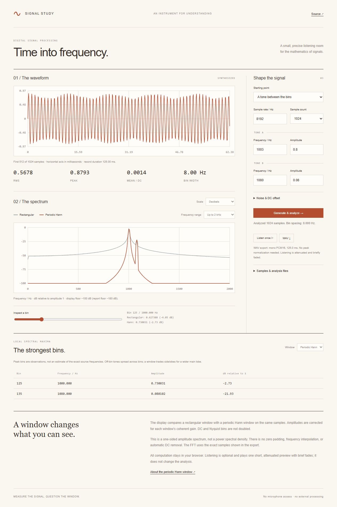

# Signal Study

A browser-based signal-processing instrument: synthesize deterministic waveforms, inspect a radix-2 FFT, compare rectangular and periodic Hann windows, and export exact samples, analysis JSON, or a PCM16 WAV.



## Start

```sh
python run.py --port 8000
```

Open http://127.0.0.1:8000. Python 3.10+ serves four static assets; all signal processing runs in the browser. No runtime packages, accounts, microphone access, or external processing are used. Refreshing discards edits unless you export them first.

## Explore

- **Clean tones:** at 8,192 Hz with 1,024 samples, FFT bins are 8 Hz apart. The 1,000 Hz and 1,800 Hz tones sit exactly on bins 125 and 225, with amplitudes 0.8 and 0.3.
- **Between the bins:** a 1,003 Hz tone spreads across bins. Compare rectangular sidelobes with the wider Hann main lobe, alongside a weaker 1,080 Hz tone.
- **Noise and DC:** deterministic seeded noise and an offset make repeatable experiments. Changing the seed changes the realization.
- **Inspect a bin:** move over the spectrum or use the keyboard-accessible range control to read both windows' amplitudes at a chosen frequency.
- **Listen once:** an optional short preview plays the record once at reduced gain with brief fades. There is no automatic playback, looping, or microphone capture.

The waveform plot shows at most the first 512 samples. Its caption identifies the displayed portion and the full record duration. Spectra use every sample. The full-range spectrum ends at Nyquist; optional frequency zooms change only the view. The bin inspector can still inspect the entire spectrum.

## Numerical conventions

The FFT is an iterative radix-2 Cooley–Tukey transform with bit-reversal permutation. The forward transform is unnormalized; the inverse divides by N. The implementation supports complex arrays for verification, while the interface analyzes real samples.

The periodic Hann window is `w[n] = 0.5 - 0.5 cos(2πn/N)`. The rectangular window is one everywhere. For each window, the coherent gain is the average of its samples. One-sided amplitudes are `|FFT(xw)[k]| / (N × coherent_gain)`, doubled for interior bins but not DC or Nyquist.

This is an **amplitude spectrum**, not a power spectral density. Coherent-gain correction recovers an isolated bin-centered tone's amplitude under these conventions; it does not eliminate off-bin scalloping, leakage, or overlap between nearby components. The peak table lists up to eight local maxima, not interpolated frequency estimates or a claim about the number of underlying sources.

Decibels use `20 log10(amplitude)` relative to amplitude one. Reports floor amplitudes at `1e-9` for logarithms, giving −180 dB for silence. The chart clips its display at −100 dB. There is no zero padding, detrending, automatic DC removal, or interpolation. Bin spacing is sample rate divided by record length.

The UI generates two zero-phase sine components. The core API supports up to four tones with phase controls. Frequencies range from DC through Nyquist; a zero-phase sine at DC is zero, and a Nyquist sine depends on phase. Frequencies above Nyquist are rejected rather than silently aliased.

## Samples, imports, and exports

Use 32–4,096 samples, in a power-of-two count, with finite amplitudes from −6 to 6. Sample rates are integer values from 8,000 to 96,000 Hz. Tone amplitudes are 0–1; noise amplitude 0–1; DC offset −1 to 1.

Import a single amplitude sequence separated by commas or whitespace, without a header or time column. The file does not carry its sample rate: set the sample rate before importing. Files are limited to 400 KB and 100,000 decoded characters, with strict UTF-8 decoding. Imported samples are analyzed directly; pressing Generate & analyze later replaces them with the configured synthetic waveform.

- **Samples:** one full-precision amplitude per line; can be imported again.
- **Analysis JSON:** the original samples, sample rate, statistics, coherent gains, every one-sided bin, and peak bins for both windows.
- **WAV:** mono little-endian PCM16. If the record peak exceeds one, all samples are multiplied by its reciprocal before quantization. The UI and analysis report disclose this scale. No window or fade is applied to the WAV export.

Listening uses a separate gain of `0.15 / max(1, peak)` and fades of up to 10 ms at both ends. It does not modify the underlying analysis or exports. Audio stops when inputs change or the page becomes hidden. Browser audio availability may vary; downloads and analysis work independently.

## Verification

Node.js 22+ and Python 3.10+:

```sh
node --test
npm run check
python -m unittest discover -s tests -v
```

Ten JavaScript tests compare the FFT against an independent direct complex DFT, check inverse reconstruction and Parseval energy, verify bin-centered amplitudes under both windows, exercise DC/Nyquist scaling, measure distant leakage reduction, validate deterministic noise and parser bounds, and check WAV headers, normalization, and signed sample endpoints. One Python test checks the local static server boundary.

Browser checks cover known spectral amplitudes, linear/dB views, bin inspection, an optional preview, above-Nyquist rejection, stale-export disabling, and sample-file round trips. A downloaded WAV was also read with Python's `wave` module to verify mono PCM16, 8,192 Hz, and 1,024 frames. CI runs Linux with Node 22/24 and Windows with Node 24.

## Structure

`core.js` contains pure synthesis, FFT, spectral analysis, parsing, and WAV encoding. `app.js` connects controls, SVG plots, file handling, and optional Web Audio playback. `run.py` is a loopback-only development server with an asset allowlist and restrictive content security policy, not a production server.

FFT runtime is O(N log N), with O(N) working memory. Plot and report size are bounded by the 4,096-sample input limit. Source formatting is configured in `.prettierrc.json`.

## Background

- [SciPy's Hann-window documentation](https://docs.scipy.org/doc/scipy/reference/generated/scipy.signal.windows.hann.html) distinguishes periodic spectral-analysis windows from symmetric filter-design windows.
- [Julius O. Smith, Spectrum Analysis Windows](https://ftp.dsprelated.com/freebooks/sasp/Spectrum_Analysis_Windows.html) discusses windowing finite records for spectrum analysis.
